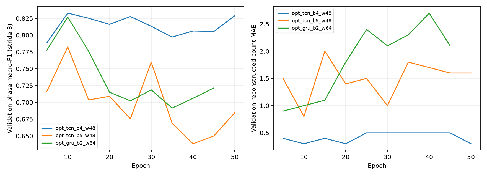

# 算法 2 优化、自检与交接记录

## 当前部署结论

当前默认算法是 **opt_tcn_b4_w48**，checkpoint 为 `artifacts/opt_tcn_b4_w48.pt`。部署仍使用 HTTP API v1，系统端关键点协议与四动作枚举保持兼容。
网络是分层 TCN，4 个残差 block（每个含两次因果卷积）、宽度 48，输入 stable80 特征、64 帧因果窗口。最佳 checkpoint 来自 epoch 10。
Decoder `ordered_transition`，阶段证据阈值 0.25，消抖 0.033 秒。
权重 SHA-256：`860da96e399fda20f4e2d06b3f198574ca91c1afd5e32101dece5977e35f53c5`。

## 优化前后

下列阶段指标是联合动作／阶段弱标签 Macro-F1；MAPE 只统计八个非零计数会话，MAE 包含两个负会话。

| 指标 | 原默认模型 | 当前默认模型 |
|---|---:|---:|
| 验证动作 Macro-F1 | 0.8399 | 0.9769 |
| 验证阶段 Macro-F1 | 0.7168 | 0.8312 |
| 验证计数 MAE | 1.0000 | 0.1000 |
| 测试动作 Macro-F1 | 0.8213 | 0.9612 |
| 测试阶段 Macro-F1 | 0.7007 | 0.8203 |
| 测试计数 MAE | 1.8000 | 0.1000 |
| 测试计数 MAPE % | 23.4722 | 1.2500 |
| 测试完整周期 recall | 0.7692 | 0.9872 |
| 测试完整周期 precision | 1.0000 | 1.0000 |
| 参数量 | 55,185 | 62,453 |
| CPU P50 ms | 10.268 | 5.880 |
| CPU P95 ms | 15.013 | 8.009 |

CPU 单次前向测量不包含特征提取、姿态 CNN、网络传输和排队，旧模型使用 64 帧，新模型使用其实际窗口。三个优化模型在全部训练完成后、统一校准时重新计时：4 个 CPU 线程、40 次预热、300 次测量。旧／新默认模型另外使用同一轮计时作部署审计，见 deployment_audit.json。参数量、窗口长度和实际延迟共同解释计算成本。

## 自检发现与修改

1. 首轮 17 类联合输出把动作类别和阶段一起竞争，多种动作的静止站姿近似相同。新网络使用一个五类动作头和四个条件阶段头，动作 CE 与当前动作阶段 CE 分开优化。联合概率为 P(action) × P(phase|action)，接口仍输出原 17 类概率。
2. 原归一化分母依赖投影腿长，屈膝、抬腿时可能随姿态变化。stable80 以两肩中心到双髋中心的二维躯干长度乘 2 归一化，加入左右膝／踝高度、较高膝／踝及左右高度差，保留单侧运动。它仍受投影和躯干倾斜影响，不能声称完全视角不变。
3. 原重叠窗口的所有位置都计算损失，早期位置的历史较短。新训练只监督每个窗口最后八帧；窗口分别为 96、128、96 帧，避免主要损失来自缺少历史的位置。所有时间运算仍因果。
4. 原训练以孤立片段为主，部署输入是连续流。新训练加入训练参与者的跨重复重建序列，不向模型传入 episode、clip boundary、来源计数或未来帧。
5. 训练增加 0.85／1.0／1.15 采样步长、左右镜像及语义交换、25／45／65 度投影、特征噪声 0.025。归一化均值和标准差仅由训练参与者拟合。
6. TCN 残差支路与输入加入逐帧 LayerNorm，使用 AdamW、余弦学习率、权重衰减、梯度裁剪与轻度 label smoothing。没有以 MLP 代替时序模型。

7. 四 block TCN 的理论感受野是 61 帧。训练后把部署窗口从 96 缩到 64，重新推理全部验证片段与会话，核对最大概率差、逐帧阶段／动作 argmax 一致，再统一校准与测速。五 block TCN 感受野 125 帧，保持 128；GRU 保持 96，未套用有限卷积感受野推断。缩窗只改部署 metadata，原训练 checkpoint 备份在 reports/optimization/training_checkpoints。

这些修改作为共同优化方案应用于三个架构；本轮没有对每项修改作单独消融，因此不能把总提升归因于其中某一项。

## 实际开发与修复过程

先完成原模型、特征、评估与漏计审计，保存首轮实验和部署配置；随后实现分层网络、stable80 特征、窗口长度随 checkpoint 加载，并新增因果性／概率合成／特征不变性测试。
第一次优化运行完成四 block TCN 的训练与验证后，构造五 block TCN 的 128 帧数据时，NumPy 无法申请约 994 MiB 的连续窗口数组。重叠窗口全部预展开还会保留源数组，产生较大峰值内存。改为 CausalWindowDataset：源序列只保存一份，按批次即时切片和起始帧填充；测试逐项核对新旧窗口和监督标签完全一致。
保留已完成的四 block TCN 权重和记录，仅继续五 block TCN 与 GRU。没有因为内存错误改动标签、划分或减少评估会话。最终训练日志、完整概率缓存、选择锁与部署自检共同用于核对实际结果。

## 实验配置与选择

| 候选 | 部署窗口 | 最佳 epoch | 实际训练 epoch | 验证动作 F1 | 验证阶段 F1 | 验证 MAE | 测试动作 F1 | 测试阶段 F1 | 测试 MAE | 测试 MAPE | CPU P50 ms |
|---|---:|---:|---:|---:|---:|---:|---:|---:|---:|---:|---:|
| opt_tcn_b4_w48 | 64 | 10 | 50 | 0.9769 | 0.8312 | 0.10 | 0.9612 | 0.8203 | 0.10 | 1.25% | 5.880 |
| opt_tcn_b5_w48 | 128 | 10 | 50 | 0.9113 | 0.7768 | 0.50 | 0.9234 | 0.7910 | 0.50 | 6.81% | 8.808 |
| opt_gru_b2_w64 | 96 | 5 | 45 | 0.8910 | 0.7763 | 0.80 | 0.9659 | 0.8246 | 0.00 | 0.00% | 13.706 |

三个候选是首轮表现较强的 TCN／GRU 家族的优化版本；没有重训全部 11 个首轮配置。最大 80 epoch，seed=2026，每五个 epoch 验证，连续八次验证未改善就提前结束。checkpoint 先按验证计数 MAE，再按验证阶段 F1 选。训练期间阶段 F1 每三帧计算一次以降低成本，候选最终比较使用完整逐帧指标。

AdamW lr=0.0015，最小 lr=0.00005，weight_decay=0.005；batch=128，窗口 stride=12；dropout=0.15，梯度裁剪 1.0；loss=0.7×action_CE + phase_CE。动作 label smoothing=0.04，阶段=0.025，类别权重为训练频率的 -0.35 次幂。

训练 checkpoint 的验证计数解码比较两种顺序策略 × 三个阈值（0.25／0.35／0.5）× 两种消抖（0.067／0.1 秒），共 12 种组合。训练后统一校准三个候选的完整验证概率，加入 0／0.033 秒消抖，共 24 组。优先最低 MAE，再看周期 recall、较长消抖和较高阈值。
额外验证诊断发现：四 block TCN 的动作支持门槛在 0.05／0.1／0.15／0.2 范围内均为 MAE=0.3，因此保持 0.15；消抖从 0.1 降到 0.033 秒能把验证 s07 抬腿计数从 7/10 提高到 9/10，负样本仍为零。这促成了训练后统一 decoder 校准；测试数据未用于该诊断。
最终候选选择规则：`validation count MAE <= best+.2; joint phase F1 >= eligible best-.02; minimum CPU p50`。选择锁文件在测试阶段之前生成，包含部署模型、decoder、时间戳和 checkpoint 哈希，finalize 会核对哈希。

## 测试逐会话结果

| 会话 | 来源计数 | 原默认预测 | 优化默认预测 |
|---|---:|---:|---:|
| s09_m05_reconstructed | 9 | 2 | 9 |
| s10_m05_reconstructed | 9 | 9 | 9 |
| s09_m01_reconstructed | 10 | 10 | 10 |
| s10_m01_reconstructed | 10 | 10 | 10 |
| s09_m06_reconstructed | 10 | 10 | 10 |
| s10_m06_reconstructed | 10 | 0 | 9 |
| s09_m02_reconstructed | 10 | 10 | 10 |
| s10_m02_reconstructed | 10 | 9 | 10 |
| s09_m07_reconstructed | 0 | 0 | 0 |
| s10_m07_reconstructed | 0 | 0 | 0 |

## 验证范围与限制

标签、参与者划分、评估角度、计数真值和事件匹配容差保持首轮定义。训练 s01–s06，验证 s07–s08，测试 s09–s10。原 test 在首轮与问题诊断中已经查看，本轮保留它用于同口径描述性比较；锁定流程避免了本轮按测试分数选模型，但不能把已使用的 test 恢复成全新盲测。

验证集只有两人；epoch 与 decoder 多次比较存在过拟合风险。结果为公共 mocap 二维投影、弱阶段标签及重建回放，未验证自然连续 RGB 视频或老人群体。一个 seed 的改善不等于统计显著，数量正确也不保证每个事件时间均正确。当前结果不证明预防跌倒的临床效果。

优化 GRU 的测试动作 F1=0.9659、阶段 F1=0.8246、计数 MAPE=0%，在这份已使用测试回放上数值略优。但它的验证计数 MAE=0.80，高于 TCN 的 0.10，且 CPU 延迟较高，因此保留测试前选择的 TCN 作为部署默认。区分测试数值最优与验证／计算折中最优，避免按已看到的测试结果改选。

## 复现与文件

```powershell
Set-Location E:\gc2-project-algorithm\algorithm2
.\.venv\Scripts\python.exe scripts/optimize_top.py --epochs 80 --seed 2026
.\.venv\Scripts\python.exe scripts/optimize_top.py --calibrate
.\.venv\Scripts\python.exe scripts/optimize_top.py --finalize
.\.venv\Scripts\python.exe scripts/robustness.py
.\.venv\Scripts\python.exe scripts/audit_optimized.py
.\.venv\Scripts\python.exe -m pytest -q
.\.venv\Scripts\python.exe scripts/build_optimization_report.py
.\.venv\Scripts\python.exe scripts/build_report.py
```

重新训练会改写同名优化 checkpoint，请在独立项目副本复现或先归档。原始基线记录保存在 `reports/optimization/baseline/`，首轮 `.pt` 权重保留在 artifacts。
`validation.json`：训练日志与完整验证指标；`selection_lock.json`：测试前锁定；`results.json`：三个候选完整结果；`*_probabilities.npz`：逐帧及会话概率；`reports/comparison.csv`：包含旧轮和优化轮的总表。完整 API 契约见 [API.md](API.md)。

## 固定部署模型追加自检

两个测试肩部动作回放分别指定四种训练目标，共八项检查，计数均为 0；同一静止姿态连续 300 帧对四目标均为 0。这些检查只覆盖已记录负样本，不代表所有家庭干扰均不会误计。

| 同轮 CPU 测量 | 窗口 | P50 ms | P95 ms |
|---|---:|---:|---:|
| gru_b2_w64 | 64 | 8.926 | 9.964 |
| opt_tcn_b4_w48 | 64 | 5.619 | 7.490 |

该轮用同一线程数、预热和测量次数，优化 TCN 比旧 GRU 的实际单次推理更快，尽管参数多约 13%。

## 固定模型压力测试

八个正会话的投影／坐标噪声检查；模型及阈值没有据此修改。

| 投影视角 | 噪声标准差（原始单位） | 正会话 MAE | MAPE |
|---|---:|---:|---:|
| 15° | 0 | 1.375 | 15.00% |
| 45° | 0 | 0.125 | 1.25% |
| 75° | 0 | 1.500 | 15.00% |
| 45° | 1 | 2.375 | 24.58% |

常规 45°投影提升明显，但极端角度和噪声下仍有明显漏计，例如 15° 的 s09 坐站为 0/9。平均精度的提升没有解决摄像头域偏移和全部视角问题。

## 训练曲线


