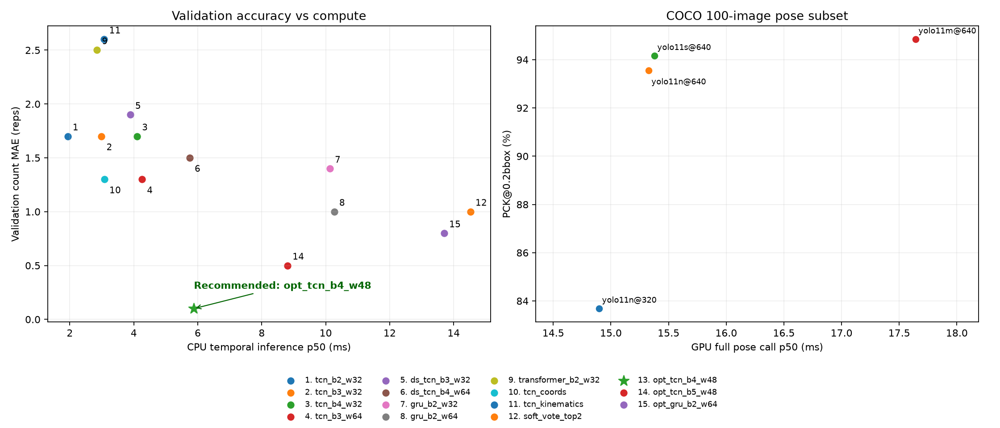
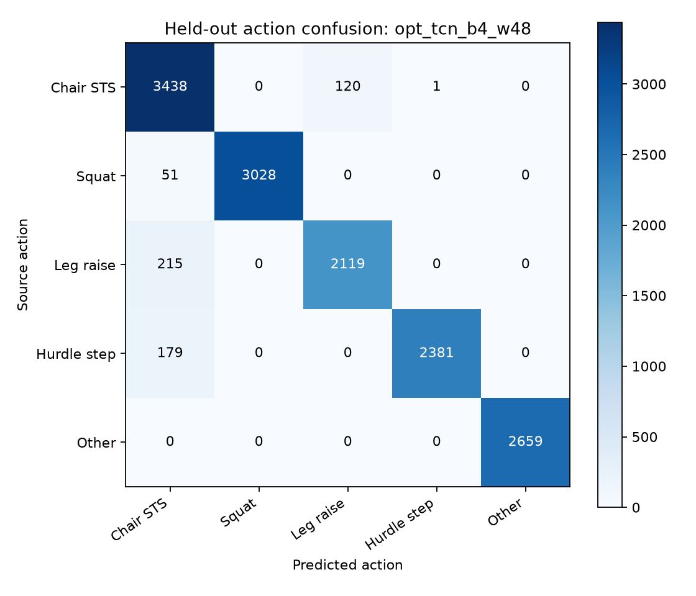
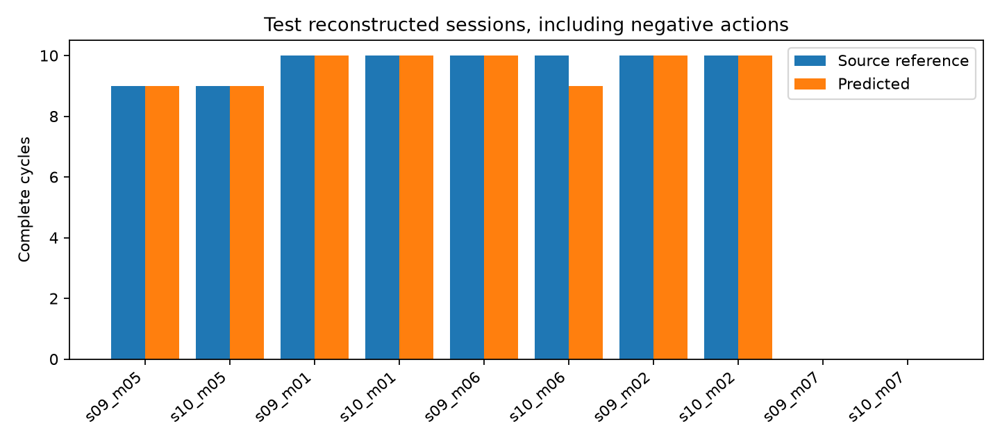

# HomeEase 四动作算法 2 实验结果

## 最佳算法结果速览

> **综合最佳、当前部署推荐：分层因果 TCN `opt_tcn_b4_w48`**
> 验证计数 MAE **0.10 次**；测试计数 MAPE **1.25%**；测试动作 Macro-F1 **0.9612**；CPU P50 **5.880 ms**。

> **测试回放指标最高：优化 GRU `opt_gru_b2_w64`**
> 测试计数 MAPE **0.00%**；测试动作 Macro-F1 **0.9659**；测试联合阶段 Macro-F1 **0.8246**。

| 核心指标 | **综合最佳 TCN（推荐部署）** | **测试指标最高 GRU** |
|---|---:|---:|
| 模型标识 | **`opt_tcn_b4_w48`** | **`opt_gru_b2_w64`** |
| 验证动作 Macro-F1 ↑ | **0.9769** | **0.8910** |
| 验证联合阶段 Macro-F1 ↑ | **0.8312** | **0.7763** |
| 验证计数 MAE ↓ | **0.10 次** | **0.80 次** |
| 测试动作 Macro-F1 ↑ | **0.9612** | **0.9659** |
| 测试联合阶段 Macro-F1 ↑ | **0.8203** | **0.8246** |
| 测试计数 MAE ↓ | **0.10 次** | **0.00 次** |
| 测试计数 MAPE ↓ | **1.25%** | **0.00%** |
| 测试相对计数 accuracy ↑ | **98.75%** | **100.00%** |
| 测试会话完全正确率 ↑ | **90.0%** | **100.0%** |
| 测试周期 recall ↑ | **0.9872** | **1.0000** |
| 测试周期 precision ↑ | **1.0000** | **1.0000** |
| CPU 时序前向 P50 ↓ | **5.880 ms** | 13.706 ms |
| CPU 时序前向 P95 ↓ | **8.009 ms** | 19.330 ms |
| 参数量 | 62,453 | 58,005 |

**为什么推荐 TCN：**它的验证计数 MAE 为 **0.10 次**，低于 GRU 的 0.80 次；GRU 的 CPU P50 是 TCN 的 **2.33 倍**。因此根据验证表现和计算成本选择 TCN，保留 GRU 作为测试回放精度最高的候选。模型与 decoder 已在本轮测试前锁定。

以上 F1 是 Macro-F1；阶段标签为运动学弱标签。MAE 包含十个会话（八正、两负），MAPE 排除两个零参考会话；相对计数 accuracy=100%−MAPE，不是分类正确率。CPU 是本机单次时序前向，未包含 Pose CNN、HTTP、特征提取和排队开销。

## 优化前后：原默认 GRU → 综合最佳 TCN

| 指标 | 原默认 `gru_b2_w64` | **优化后 `opt_tcn_b4_w48`** |
|---|---:|---:|
| 测试动作 Macro-F1 | 0.8213 | **0.9612** |
| 测试联合阶段 Macro-F1 | 0.7007 | **0.8203** |
| 测试计数 MAE | 1.80 次 | **0.10 次** |
| 测试计数 MAPE | 23.47% | **1.25%** |
| 测试周期 recall | 0.7692 | **0.9872** |

测试动作 F1 提升 **13.99 个百分点**；计数 MAE 降低 **94.44%**。这是同一标签与划分下的描述性对照。

## 综合最佳 TCN 的四动作效果

**77/78 个参考周期匹配成功，漏计 1 个，多计 0 个。** 两个肩部动作负会话均为 0 次。

| 动作 | 参考周期总数 | 预测周期总数 | MAE 次 | MAPE | 会话完全正确率 | 周期 recall | 周期 precision |
|---|---:|---:|---:|---:|---:|---:|---:|
| 椅子坐站 `chair_sit_to_stand` | 18 | **18** | 0.00 | **0.00%** | 100.0% | 1.000 | 1.000 |
| 深蹲 `squat` | 20 | **20** | 0.00 | **0.00%** | 100.0% | 1.000 | 1.000 |
| 站立直腿抬腿 `standing_leg_raise` | 20 | **19** | 0.50 | **5.00%** | 50.0% | 0.950 | 1.000 |
| 跨步抬腿 `hurdle_step` | 20 | **20** | 0.00 | **0.00%** | 100.0% | 1.000 | 1.000 |

每动作仅两名测试参与者。周期时间匹配使用弱边界 ±0.5 秒；数量参考来自原始分段重复。

## 最佳算法部署配置

实际加载权重：`opt_tcn_b4_w48.pt`，见 `artifacts/selected.json`。Decoder 为 `ordered_transition`，阶段证据阈值 0.25，消抖时长 0.033 秒，部署窗口 64 帧。默认姿态前端：**yolo11n-pose.pt @ 640**。系统接入见 [API.md](API.md)，完整优化过程见 [OPTIMIZATION.md](OPTIMIZATION.md)。

部署选择规则：`validation count MAE <= best+.2; joint phase F1 >= eligible best-.02; minimum CPU p50`。原测试集在前一轮已经查看，本轮先锁定验证集选择，再复用测试集作描述性比较，不视为全新盲测。公开骨架投影、弱标签和重建回放结果不等于老人家庭视频性能。

## 完整模型对比（最佳候选置顶）

| 模型与定位 | 参数 | CPU P50 ms | 验证 MAE | 测试动作 F1 | 测试联合阶段 F1 | 测试 MAE | 测试 MAPE |
|---|---:|---:|---:|---:|---:|---:|---:|
| **opt_tcn_b4_w48（综合最佳／推荐部署）** | **62,453** | **5.880** | **0.10** | **0.9612** | **0.8203** | **0.10** | **1.25%** |
| **opt_gru_b2_w64（测试指标最高）** | **58,005** | **13.706** | **0.80** | **0.9659** | **0.8246** | **0.00** | **0.00%** |
| tcn_b2_w32 | 15,057 | 1.935 | 1.70 | 0.8307 | 0.7010 | 2.20 | 28.47% |
| tcn_b3_w32 | 21,265 | 2.992 | 1.70 | 0.8315 | 0.7081 | 1.10 | 13.75% |
| tcn_b4_w32 | 27,473 | 4.104 | 1.70 | 0.8823 | 0.7463 | 2.10 | 27.36% |
| tcn_b3_w64 | 79,377 | 4.258 | 1.30 | 0.8421 | 0.7208 | 1.90 | 24.86% |
| ds_tcn_b3_w32 | 9,745 | 3.890 | 1.90 | 0.8420 | 0.7162 | 1.30 | 16.25% |
| ds_tcn_b4_w64 | 40,593 | 5.748 | 1.50 | 0.8407 | 0.7056 | 2.10 | 26.53% |
| gru_b2_w32 | 15,313 | 10.131 | 1.40 | 0.8175 | 0.6760 | 1.90 | 25.00% |
| gru_b2_w64 | 55,185 | 10.268 | 1.00 | 0.8213 | 0.7007 | 1.80 | 23.47% |
| transformer_b2_w32 | 19,729 | 2.851 | 2.50 | 0.8645 | 0.7142 | 3.00 | 37.78% |
| tcn_coords | 19,985 | 3.082 | 1.30 | 0.8208 | 0.6803 | 2.00 | 25.14% |
| tcn_kinematics | 19,729 | 3.076 | 2.60 | 0.7042 | 0.6302 | 1.70 | 22.08% |
| soft_vote_top2 | 134,562 | 14.526 | 1.00 | 0.8397 | 0.7250 | 1.40 | 18.06% |
| opt_tcn_b5_w48 | 76,469 | 8.808 | 0.50 | 0.9234 | 0.7910 | 0.50 | 6.81% |

集成行延迟为各成员独立测量之和，尤其 P95 相加不是实测联合 P95。首轮 seed=42，优化轮 seed=2026；未做多种 seed 的统计重复。CPU 是本机测量，旧轮与新轮计时条件可能不同。

## 逐测试会话

| 重建会话 | 来源参考 | 预测 |
|---|---:|---:|
| s09_m05_reconstructed | 9 | 9 |
| s10_m05_reconstructed | 9 | 9 |
| s09_m01_reconstructed | 10 | 10 |
| s10_m01_reconstructed | 10 | 10 |
| s09_m06_reconstructed | 10 | 10 |
| s10_m06_reconstructed | 10 | 9 |
| s09_m02_reconstructed | 10 | 10 |
| s10_m02_reconstructed | 10 | 10 |
| s09_m07_reconstructed | 0 | 0 |
| s10_m07_reconstructed | 0 | 0 |

## 姿态 CNN 对比

100 张官方 COCO val 图像，198 个标注人体，2,482 个可见关键点。此处不是全量 COCO AP，PCK 阈值为 bbox 最长边的 20%，漏检计错。

| Pose CNN | 输入 | PCK@0.2 | 平均 OKS | 匹配人体 | GPU P50 ms | GPU P95 ms | 参数 |
|---|---:|---:|---:|---:|---:|---:|---:|
| yolo11n-pose.pt | 320 | 83.68% | 0.6624 | 171/198 | 14.90 | 98.54 | 2,874,462 |
| yolo11n-pose.pt | 640 | 93.55% | 0.7811 | 190/198 | 15.33 | 98.22 | 2,874,462 |
| yolo11s-pose.pt | 640 | 94.16% | 0.8190 | 190/198 | 15.38 | 74.32 | 9,918,238 |
| yolo11m-pose.pt | 640 | 94.84% | 0.8460 | 190/198 | 17.64 | 60.70 | 20,912,364 |

计时包含预处理、前向与后处理，并做 CUDA 同步。P50 达到 30 FPS 的预算不代表 P95 能达到，也不包含所有系统开销。

## 图表

## 是否达到 proposal 的目标

当前默认模型重建回放总体 MAPE 为 1.25%。在该有限回放上达到 ≤5%，但尚不能宣布家庭视频验收完成。

代码、训练权重、四动作识别与计数流程、接口和离线实验已实现。下一步应使用独立人工标记的自然连续摄像头视频，包含老人、不同视角、遮挡及日常干扰，然后验证真实前端的关键点误差和完整周期性能。

## 固定模型的视角与噪声测试

下表只包含四动作的八个正会话，因此 MAE 的分母与含两个负会话的主表不同；模型与阈值没有根据这些测试结果修改。噪声单位是 UI-PRMD 原始长度单位，不是特定摄像头的像素。

| 投影视角 | 坐标噪声标准差 | 正会话 MAE | MAPE |
|---|---:|---:|---:|
| 15° | 0 | 1.375 | 15.00% |
| 45° | 0 | 0.125 | 1.25% |
| 75° | 0 | 1.500 | 15.00% |
| 45° | 1 | 2.375 | 24.58% |

未见训练参与者的 15°／75°视角是投影鲁棒性压力测试，不能替代实际摄像头角度验收。

本文件由 `scripts/build_report.py` 从实际实验 JSON 生成。开发方法和评估限制见 [DEVELOPMENT.md](DEVELOPMENT.md)。
