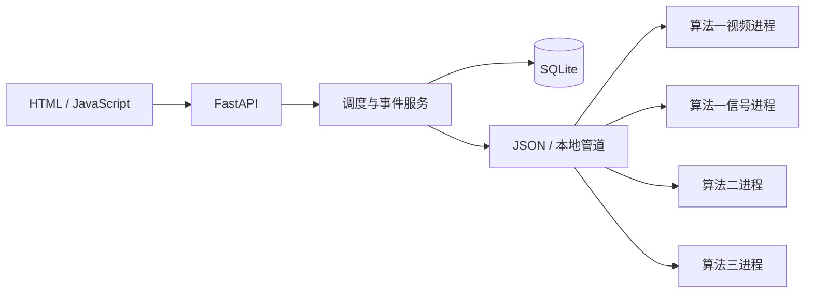

# 架构与算法集成

## 调用边界

`care/main.py` 负责 HTTP/WebSocket、输入边界与访问控制；`services.py` 负责流程调度；`events.py` 负责处置与通知；`storage.py` 负责事务和持久化；`adapters/process.py` 负责隔离进程、超时和回收；`workers.py` 仅适配原 SDK 的调用入口。前端位于 `web/templates` 和 `web/static`。

各模块可以通过 `AlgorithmProcess("video" | "signal" | "exercise" | "audio")` 独立初始化、调用与关闭；`scripts/verify_integrations.py --module NAME` 独立验证。算法2与算法3都包含 `homeease` 包，独立进程避免 import 冲突，也使单个算法故障与报告、其他算法隔离。

## 保持原行为

视频引擎按交付代码要求在运行目录建立 `systems/` 与相邻 `standalone/`，源文件按字节复制；原算法目录保持原样。使用其 `DetectionEngine`、默认阈值、连续确认、窗口、冷却、采样及片段保存逻辑。H.264 转码仅创建浏览器播放副本，原始证据片段不覆盖。

信号模块使用原 `BestFallModel`、`detect_offline` 与 `StreamingDetector`。交付 CSV 读取器的四列补齐行为与实际读取索引不匹配，故明确单位的四列 CSV 在适配层转换成原生五列格式，再交给原读取器。特征、重采样、模型概率、事件规则均由原代码执行。

运动模块在隔离进程中调用原 FastAPI app 的契约，包括批次幂等、参数校验、会话状态、计数与中断处理。摄像头及上传视频交给原 `PoseEstimator` 后使用原 `/v1/sessions/{id}/frames`，不重写周期计算。`care/camera.py` 按设备序号只打开一次摄像头，通过带序号一致性检查的共享内存传递原始 BGR 像素。视频仅适配 `FrameSource` 的摄像头入口，文件与回放仍用原入口。运动使用采集的单调时钟、单个在途推理；暂停和结束与帧提交共用会话锁。最后一个算法使用者退出后关闭摄像头，浏览器预览不拥有设备。

视频预览以 MJPEG 连续传输，与每 2.5 秒的界面状态轮询分开。视频进程默认 OpenCV 4 线程，保留原检测步长、A4 判定步长、15 FPS 采样目标和全部模型参数。不能通过重复显示缓存帧声称提高推理帧率，页面显示原引擎实测推理 FPS。

声音模块严格初始化原 Silero，不静默换用 Energy VAD。离线联合分析把同一次解码结果依次交给原 `label_sounds` 和 `detect_spoken_help`；连续 PCM 使用原 `Function3Pipeline`、`SoundMonitor` 和 `HelpListener`，同时执行全部类别识别与求助监听。询问结论及通道标记直接调用原 policy。声音类别不自行转为跌倒结论；视频与信号同时运行、独立判定，不合成为新的跌倒模型。

## 状态与恢复

- 原疑似跌倒建立 PENDING 事件，主动求助建立 EMERGENCY 事件。语音求助按原 policy 升级；表示安全仅作为待核实信息。只有照护者明确记录结果才关闭事件。
- 问询记录播放成功、监听、识别、不可用、完成状态。未播放与音频故障不视作安全。录音 10 秒，网络传输另有短暂余量，识别使用独立有界等待。
- 事件写入有去重键与修订号；重复输入不重复创建同一次事件，过期的处置更新返回冲突。回放与实时在数据库、通知和报告中均区分。
- 模块错误与调用耗时进入日志。超时回收该模块进程；可在设置页重新初始化。Windows 同时追踪 venv 启动器与其真实工作进程，回收自身子进程，不按进程名称结束其他程序。
- 实时输入超时、未检测到人、传感器断开、音频流水线降级分别记录覆盖状态。浏览器训练数据超过 10 秒未到达时暂停原会话。重启把未结束训练标为中断，依据心跳恢复离线区间。
- 共享摄像头训练由页面定期查询维持会话心跳；浏览器离开时请求结束，心跳超过 15 秒仍未恢复时结束训练并释放该使用者，不停止独立的视频跌倒检测。
- WebSocket 显式停止确认在原流水线关闭和锁释放后发送。关闭摄像头、音频流及传感器时释放浏览器设备；传感器断开前排空已排队的数据。
- SQLite 使用 WAL、外键和事务。配置默认未授权音频，录音与识别文字不持久化。音频结果在授权撤回后丢弃。

## Proposal 对应

实现了照护者工作台与简化长者页，当前覆盖、事件证据、通知与联系人、回应及人工处置、运动记录、7/30/90 天统计及导出。未生成没有原算法依据的姿势分、平衡分、临床风险分或识别准确率。Proposal 的性能和持续运行目标属于待评测指标，界面不把它们当成已达成结果。
